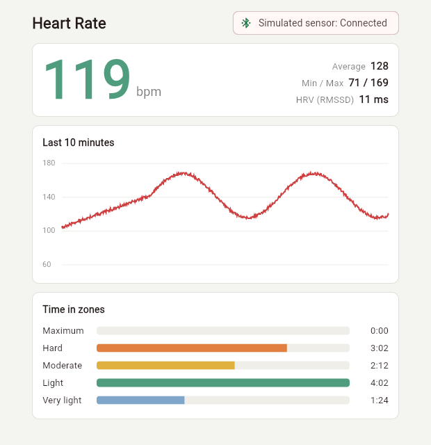

# Heart Rate Monitor: Flutter and Bluetooth LE

A Flutter app for standard BLE heart rate sensors: live reading, zones, heart rate variability and signal-loss handling. It follows the Bluetooth Heart Rate Service, so it isn't tied to one brand of strap.



## How it's built

- **Parser for the Heart Rate Measurement characteristic (0x2A37):** 8-bit and 16-bit heart rate, skin contact, energy expended and RR intervals in units of 1/1024 second. A malformed frame raises an error instead of returning garbage, and a corrupt notification doesn't end the session.
- **Session logic in pure Dart:** min, max, average, time in zones, and RMSSD with sensor artefacts removed. Readings without skin contact are ignored, and time across a dropped connection doesn't count toward any zone.
- **Two sources behind one interface:** a BLE source that scans for the Heart Rate service, subscribes and reconnects with backoff, and a simulator that builds the same bytes a strap sends, so the demo runs through the real parser.

## Run

```bash
flutter test
flutter run -d chrome
flutter run --dart-define=SENSOR=ble
```

The first two use the simulator. The third needs a phone and a real sensor.

## Tests

14 tests cover every field of the measurement format, malformed frames, zones, dropped connections, RMSSD on known intervals and the simulator's output. `flutter analyze` reports no issues.

## Limits

The screenshot and tests use the simulated sensor. The Android build succeeds with the BLE source included, but it hasn't been run against a physical strap in this repo. The numbers are for fitness use and are not a medical measurement. `flutter_blue_plus` has its own license terms, so check them for commercial use.
